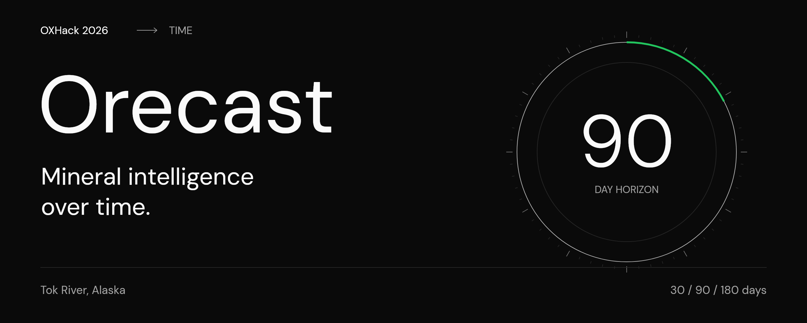
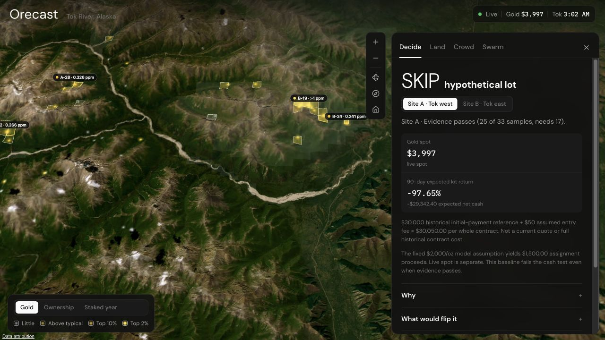
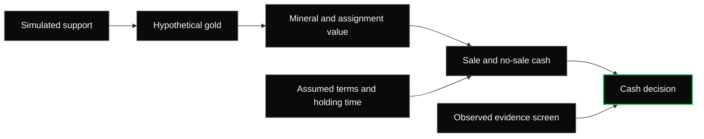

<p align="center">
  
</p>

# Orecast

**Mineral intelligence over time.**

[Explore the demo](https://oxhack-land-arbitrage.vercel.app) · [Follow the swarm](https://oxhack-land-arbitrage.vercel.app/swarm) · [Pitch PDF](pitch/orecast/output/orecast-pitch.pdf) · [Editable deck](pitch/orecast/output/orecast-pitch.pptx) · [Run locally](#run-locally)

Orecast brings geological evidence, simulated stakeholder reactions and time-dependent
contract economics into one inspectable decision. Explore Tok River, Alaska, follow
news through a stakeholder swarm, and see whether a hypothetical mineral-interest
option is worth acquiring and assigning before expiry.

Built at **OXHack 2026** for the theme **TIME**.

| Real ground | Recorded simulations | Decision windows |
| :--- | :--- | :--- |
| **67** historical sediment samples | **6** scored swarm runs | **30 / 90 / 180** days |

<p align="center">
  <a href="https://oxhack-land-arbitrage.vercel.app">
    
  </a>
</p>

*Earlier deployed explorer capture, showing the previous cost-only SKIP fixture.
The approved current synthetic exposure is described below. Live spot is capture-time
context, separate from model gold. Imagery: Esri, Maxar and Earthstar Geographics. Terrain: Mapzen.*

## A promising sample is only the beginning

The interesting question is what happens between finding a signal and being able to
act on it. Orecast connects the ground, the story and the clock. A geological screen
can pass while a contract still fails its cash test. A simulated news reaction can
change an assumed gold price while the option remains a **SKIP**.

Every step can be inspected. Evidence retains its source, simulations retain their
run identities, and the financial model exposes its assumptions and no-sale outcome.

## Take a tour

| View | What to explore |
| :--- | :--- |
| **Decide** | Compare the A/B evidence screens with the hypothetical whole-contract cash decision. Expand the model to adjust assumptions or inspect the historical validation. |
| **Land** | Explore sediment measurements, checked claim records and local context on the 3D globe. Select a plot and inspect its source record or terrain. |
| **Crowd** | Compare five stakeholder groups across simulated news scenarios and days. The recorded mood charts keep their simulated origin visible. |
| **Swarm** | Walk through inputs, stakeholders, support scores, the signal, gold forecast and option value. Open the full workflow for the calculation trace. |

The separate **[/swarm workflow](https://oxhack-land-arbitrage.vercel.app/swarm)**
replays pinned results and shows how each stage feeds the next. Its saved calculations
remain separate from edits in the live calculator.

## From evidence to a decision



The shared engine in [`model/tok-option/`](model/tok-option/README.md) powers the
interface, saved calculation snapshots and export CLI. It models **assignment before
expiry**, with sale proceeds, transaction costs and a separate no-sale branch.
Unsold model value stays separate from cash. The application does not execute trades.

**Time changes the answer.** The opening connects claim and gold-price history to a
labelled projection. Simulations track reactions over five simulated days. The model
compares 30, 90 and 180-day sale windows, while expiry, data availability and the chance
of remaining unsold constrain the decision. Historical evaluation uses chronological
holdouts rather than shuffled observations.

### What the current model actually says

The approved example is **one synthetic whole contract** with **US$30,000 assumed
premium**, **US$50 entry fee** and **US$50 exit fee**. The initial-payment scale comes
from two selected historical signing payments, Tibbs and Northway. It is not a
current Tok market average, available quote or full contract cost.

Its exposure is frozen once from the original invented ratio, `s = 30,000 / 650`:
**23,076.9230769 assumed troy ounces** and **US$184,615.38 remaining buyer
consideration**. These inputs do not establish measured resources or market value.
Ownership is 50%, conversion 2% and geological success 25%. Editing the premium
never resizes the exposure.

At US$2,000/oz model gold, zero growth and an assumed 20% sale hazard per 30 days,
the no-event 90-day baseline gives **US$69,230.77 conditional assignment proceeds**,
**US$3,710.22 expected net cash** and **12.35% expected option return** on
US$30,050 upfront capital. Area A is a conditional model candidate; Area B fails
the evidence screen. Candidate is not a trade or measured edge. The website's
small-response startup preset is a separate sensitivity case. Live gold is separate
from these assumed inputs.

At 90 days, **51.2% of paths have no sale**. No-sale cash and median cash are
**−US$30,050**; an unsold model mark stays separate from cash. The higher headline
return depends on the fixed US$50 fees. Scaling each reference fee proportionally
to **US$2,307.69** instead gives **1.09% return** and **US$32,307.69 upfront**, which
**fails the US$30,050 per-option risk cap**. Neither fee policy is calibrated to
actual costs.

The assumed fund is US$1,502,500, with US$30,050 per option, US$150,250 open and
lifetime commitment caps, and at most five whole positions. This capacity does not
establish available contracts. Actual work, royalty, scholarship and recurring
obligations need separate inputs.

The **US$77,022.34** assignment amount required for a **25% expected 90-day return**
is a target hurdle, separate from the US$69,230.77 model valuation. It did not
determine exposure. Returns are non-annualized. The [model guide](model/tok-option/README.md)
and [contract-pricing research](research/orecast-contract-pricing/README.md) explain
the arithmetic and limitations.

The linked deck is the previous published version. The reviewed consistent-lot slides will be published separately after this code merge. Use the [model guide](model/tok-option/README.md) and [results report](research/orecast-contract-pricing/consistent-lot-review.md) for current economics.

## Know what each layer means

| Layer | Provenance and limits |
| :--- | :--- |
| **Observed** | Historical sediment assays, checked claim records and attributed commodity history. A/B are comparison areas. Sample concentration does not establish recoverable ounces, available land or mineral rights. |
| **Simulated** | Six scored runs across five stakeholder groups, including three baseline seeds. Recorded scores are not surveyed opinion. Missing scenarios and failed research checks remain visible. |
| **Assumed** | Contract economics, recoverable quantity, sale probability and support-to-gold response. These make the mechanism reproducible; they do not establish calibrated predictive skill. |

A separate [12-announcement historical pilot](research/event-study/RESULTS.md) tested
an event adjustment against simple baselines. It performed worse on the five-event
holdout. That negative result remains part of the demonstration. The
[remaining-work guide](docs/remaining-work.md) records the data and validation needed
for a useful real trade assessment.

## Run locally

Use **Node.js 24** and npm. The committed snapshots support the local demo without
API keys, a Convex account or the full raw data packs.

```sh
git clone https://github.com/amitvijapur/oxhack-2026.git
cd oxhack-2026/frontend
npm ci --ignore-scripts
npm run dev
```

Open **[127.0.0.1:3000](http://127.0.0.1:3000/)**. Satellite imagery, terrain and live
gold observations require network access. The default globe needs no map key.
The [frontend guide](frontend/README.md) covers optional configuration and display
rules. Optional publishing and storage are documented in [infrastructure](docs/infrastructure.md).

### Verify the build

From `frontend/`:

```sh
npm test
node --test ../model/tok-option/tests/*.test.mjs
npm run test:backend
npm run typecheck:backend
npm run typecheck
npm run lint
npm run build
npm start
```

From the repository root:

```sh
python3 -m unittest discover -s tests -p test_publish_run.py
node model/tok-option/audit.mjs
node model/tok-option/demo.mjs
node --test research/event-study/evaluate.test.mjs
```

The frontend, model and local Convex-mock suites check different boundaries. The
production server binds to loopback. See [verification](model/tok-option/VERIFICATION.md)
for numerical checks and [the frontend guide](frontend/README.md) for browser smoke checks.

## Inside the repository

| Path | Purpose |
| :--- | :--- |
| [`frontend/`](frontend/README.md) | Next.js, React, TypeScript and Cesium explorer, API routes and optional Convex integration. |
| [`model/tok-option/`](model/tok-option/README.md) | Shared pure JavaScript evidence, gold, assignment, liquidity and portfolio engine. |
| [`research/`](research/) | Source contracts, acquisition steps, simulation provenance, experiments and preserved planning history. |
| [`pitch/orecast/`](pitch/orecast/README.md) | Previous published deck and notes; reviewed replacement follows the code merge. |
| [`brand/orecast/`](brand/orecast/BRAND.md) | Orecast wordmarks, DM Sans fonts, palette tokens and usage rules. |
| [`docs/`](docs/architecture.md) | Architecture, infrastructure, collaboration and remaining work. |

<details>
<summary><strong>Source packs, research and reproducibility</strong></summary>

- **Gold data:** [download both packs](research/gold-data-downloads.md), [evidence contract](research/gold-evidence-contract.md), [verified build results](research/gold-evidence-results.md), [source catalogue](research/gold-source-catalog.json), [frozen A33/B34 selection](research/gold-site-selection.json), [feasibility](research/us-gold-dataset-feasibility.md).
- **Swarm:** [no-API method and handoff](research/swarm-no-api-demo-plan.md), [integration findings](research/tok-option-model/integration-review.md).
- **Model:** [strategy and historical amendments](research/tok-option-strategy.md), [historical pilot reproduction](research/event-study/README.md), [contract-pricing primary sources](research/orecast-contract-pricing/README.md).
- **Earlier work:** [copper soil contract](research/soil-evidence-contract.md), [ideas list](research/all-ideas.md), [idea scores](research/idea-scores.md).
- **Event:** [supplied Granola ceremony notes](research/opening-ceremony-notes.md), [event context](research/event-context.md).
- **Collaboration:** [repository plan](research/repository-plan.md), [harness comparison](research/harness-comparison.md), [task ownership and progress](tasks/todo.md).

Raw sources and full generated packs are outside Git. Release downloads and pinned
acquisition commands supply them separately; the compact display snapshots are included.
For canonical JSON exports and attributed publication, follow the
[model guide](model/tok-option/README.md) and [infrastructure guide](docs/infrastructure.md).

</details>

<details>
<summary><strong>Deployment and contributing</strong></summary>

Successful CI on a push to `main` triggers the [Vercel deployment workflow](.github/workflows/deploy.yml).
PRs do not deploy or receive deployment credentials. The repository owner configures
`VERCEL_TOKEN`, `VERCEL_ORG_ID` and `VERCEL_PROJECT_ID` as GitHub Actions secrets.
Manual redeployment is available through **Actions → Deploy → Run workflow** on `main`.

Use bounded task branches and follow [the shared rules](AGENTS.md) and
[team workflow](docs/team-workflow.md). The required checks are **Frontend checks**,
**Repository checks** and **Secret scan**. Teammate review is optional; current required
checks must pass and conversations must be resolved. Amit owns integration.
[Optional team tools](docs/optional-team-kit.md) add manual debugging, cleanup and
secret scanning without another required workflow.

</details>

---

Built by [Amit](https://github.com/amitvijapur), [Muhammad](https://github.com/meep-boop),
[Arjin](https://github.com/arjn15) and [Salman](https://github.com/iloveclouduk) at OXHack 2026.

[Brand kit](brand/orecast/BRAND.md) · [Pitch and rehearsal](pitch/orecast/README.md) · [Architecture](docs/architecture.md)
