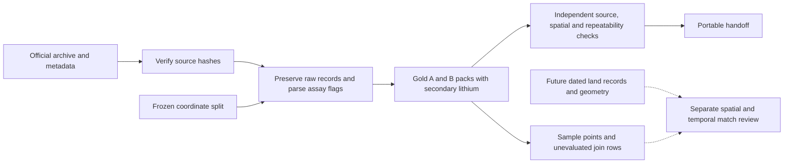

# Tok River gold evidence and future land matching

24 October 2026. Owner: Amit for both packs. Arjin can reuse the same extractor. Gold is primary and lithium is secondary. MiroFish, prompts, the decision algorithm and land-contract acquisition remain separate.

## Source identity

Use [Alaska DGGS RDF 2016-10](https://dggs.alaska.gov/pubs/id/29688), [DOI 10.14509/29688](https://doi.org/10.14509/29688). The canonical machine-readable record is [gold-source-catalog.json](gold-source-catalog.json). It records the publication, authors, direct download and metadata URLs, archive/member hashes and sizes, assay methods and limits, source dates, coordinate conventions, reuse terms and transformations. Exact source files remain unchanged outside Git.

The source ID is `alaska_dggs_rdf2016_10`. Cite a field location as `alaska_dggs_rdf2016_10:SAMPLE` and a selected analytical record as `alaska_dggs_rdf2016_10:SAMPLE:-200`. Always retain its source CSV SHA-256 as the version identifier. A name alone is not a join key. `source_csv_record_number` is the 1-based CSV data record excluding the header, not a physical text-line number.

Keep published `SAMPLE` and laboratory `LAB_SAMPLE_NUMBER` distinct, including the documented mapping differences. Keep raw batch/coordinate/assay strings; normalized numeric or trimmed fields are derived views. The full source includes 23 companion -80 mesh rows that are excluded from the primary packs and retained in the source archive.

## Approved A/B selection

[gold-site-selection.json](gold-site-selection.json) freezes all 67 -200 mesh locations and their IDs against the source and limit-table hashes. A is west of longitude -143.793381 (33 locations); B is at or east (34). Boundaries were chosen by coordinates before comparing assay values.

These are comparison windows in Tok River, Alaska. `sample_coordinate_bounds` describes the extent of included points. It is neither an official survey polygon nor a parcel, lease or mineral boundary. An overlapping window bounding box is only a search aid, never a contract match.

## Assays and summaries

The primary assay is `Au_ppm_PGM-MS23`, in ppm. Keep the raw sentinel `-2` for 16MBW012 as an upper-censored >1 ppm observation. Preserve its separate Au-AA25 retest of 1.1 ppm and method identity. Never overwrite or average the primary and retest. Blank retests mean not analyzed; `-1` means below the lower limit. The limits table supplies method-specific bounds. Unknown encodings fail extraction.

Secondary lithium uses `Li_ppm_ME-MS61`, also in ppm, and is quantified at all 67 selected locations. Summaries keep Au primary, Au retest and Li separate. Quantified-only statistics state their denominators. Include batch composition and gold summaries by batch; pooled A/B differences do not establish superior geology.

## Pack contents

- `source_records.csv`: original fields and strings for selected -200 mesh source records.
- `samples.csv`: normalized selected records with stable keys, source record references, original IDs, coordinates and separately qualified Au/Li results.
- `samples.geojson`: matching point features with stable IDs and explicit provenance properties.
- `site.json`, `selection.json`, `source_catalog.json`: area membership, source identities and spatial/time conventions.
- `summary.json`, `evidence.md`: descriptive evidence with counts, method denominators, record references and limitations.
- `land_match_template.csv`: one not-yet-evaluated row per selected sample, ready for a separate matching task. No contract IDs or relationships are populated.
- `assumptions.json`: empty scenario assumptions and explicit unknowns.
- `provenance.json`: source-to-record-to-summary relationships and input hashes.
- `validation.json`: checks and SHA-256 hashes for every other pack file.
- `README.md`: pack use and regeneration guidance.

## Coordinates for a future match

The source latitude/longitude fields are WGS84 decimal degrees. [RFC 7946](https://www.rfc-editor.org/rfc/rfc7946) GeoJSON points use `[longitude, latitude]`, equivalent to OGC:CRS84 axis order. Do not swap axes because an EPSG registry lists them differently. Preserve source precision and IDs. A GeoJSON point is the sediment sampling location, not the inferred upstream gold source.

[DGGS metadata](https://dggs.alaska.gov/webpubs/metadata/RDF2016-10.faq.html) reports GPS position error of 1–10 m. This is a survey-level reported range, not a measured uncertainty per sample or a confidence radius for a deposit. The sediment's upstream origin remains unknown.

## Future land-record join contract

Keep the result as a separate one-to-many table: one sample may intersect multiple records, interests or dated versions. Do not force one winning parcel or overwrite geological evidence. The prepared CSV contains only sample references and `match_status=not_evaluated`; empty contract fields mean no lookup has occurred, not that land is available.

The next task must preserve:

| Information | Required fields or evidence |
|---|---|
| Observation identity | sample key, source ID/hash, exact point and source record reference |
| Land-record identity | authoritative provider/source ID and URL, stable contract/claim/parcel ID, interest type |
| Time | retrieval/snapshot date plus separately stated effective-from/effective-to dates; unknowns remain unknown |
| Geometry | original CRS, original geometry hash/version and source; transform explicitly to a common CRS |
| Spatial relation | documented predicate such as point-intersects-polygon, boundary distance in metres and how it was calculated |
| Ambiguity | boundary/geometry uncertainty, overlapping candidates, missing geometry or dates, and review status |
| Evidence trail | provider record or contract-document reference; note which interest the record actually describes |

Compare exact points with authoritative geometries, not area names, nearest centroids, text addresses or our A/B bounds. Retain all candidates; boundary-touching or uncertainty-overlapping cases require review rather than a false unique match. Calculate distances geodesically or in an appropriate local projected CRS, never in decimal degrees. If provider geometry is only an approximate grid or locality, label that limitation and leave an exact parcel match unverified.

A point intersection establishes the geographic relationship of a sampling location to that version of a land record. It does not establish where the transported gold originated, ownership of minerals, drilling status, legal availability or a price. A surface parcel, mineral claim, lease and commercial contract are different record types; preserve the provider's interest type and verify the relevant instrument in the later task.

## Timing and scenario use

Collection campaigns were June/July 2016; publication was November 2016, with exact day unknown. The CSV has no individual observation/assay dates. Record publication month with its precision, and never invent daily availability. A present-day land-record match is a current spatial comparison to historical geochemistry; it is not proof that the same record or rights existed in 2016. A historical match needs historical land-record versions.

Keep assumed exploration success probabilities, future survey outcomes, costs and rewards outside the measured evidence. This dataset supports the hackathon's investigation-decision simulation, not a chronological discovery or arbitrage backtest.

## Acquisition and regeneration

Download the [official ZIP](https://dggs.alaska.gov/webpubs/data/rdf2016_010_tok-stream-sediment-geochemistry.zip) and verify SHA-256 `2ac0b7eaeeb1bf114172ad80e2afde2065a9af1946a3be163f843cb736e91d86` before extraction. Preserve its README, method tables and metadata. Extract under `data/raw/gold-feasibility/tok-river-2016/source/`, or use the portable handoff bundle with its exact source bytes.

From the repository root:

```sh
python3 scripts/gold_evidence.py --source data/raw/gold-feasibility/tok-river-2016/source/tables/rdf2016-10-stream-sed-trace-element.csv --limits data/raw/gold-feasibility/tok-river-2016/source/tables/rdf2016-10-stream-sed-trace-element-limits.csv --selection research/gold-site-selection.json --catalog research/gold-source-catalog.json --area A --output data/generated/tok-gold/site-a
python3 scripts/gold_evidence.py --source data/raw/gold-feasibility/tok-river-2016/source/tables/rdf2016-10-stream-sed-trace-element.csv --limits data/raw/gold-feasibility/tok-river-2016/source/tables/rdf2016-10-stream-sed-trace-element-limits.csv --selection research/gold-site-selection.json --catalog research/gold-source-catalog.json --area B --output data/generated/tok-gold/site-b
python3 -m unittest discover -s tests -p 'test_gold_evidence.py' -v
```

An identical rerun is accepted; changed existing output is refused. Use a fresh directory for a new version. Source or manifest mismatches must fail rather than silently producing different packs. Raw data and generated packs are ignored by Git. A pull provides code and documentation; transfer the handoff separately or acquire and verify the official source.

## Attribution and modifications

Credit Alaska DGGS and the cited authors/publication in every shared pack. Disclose filtering, splitting, normalization, summaries and GeoJSON conversion. Do not imply DGGS approved these derivatives. The source's stated use constraints travel in `source_catalog.json` and the bundled original metadata. This state release is not labelled US federal public domain.

## Build and review loop



The extractor produces evidence. A separate verifier checks it against original source rows and spatial conventions. Any mismatch returns to the extractor; source bytes and selection remain frozen. The dotted land-matching path is future work and makes no present claim about ownership or contracts.
