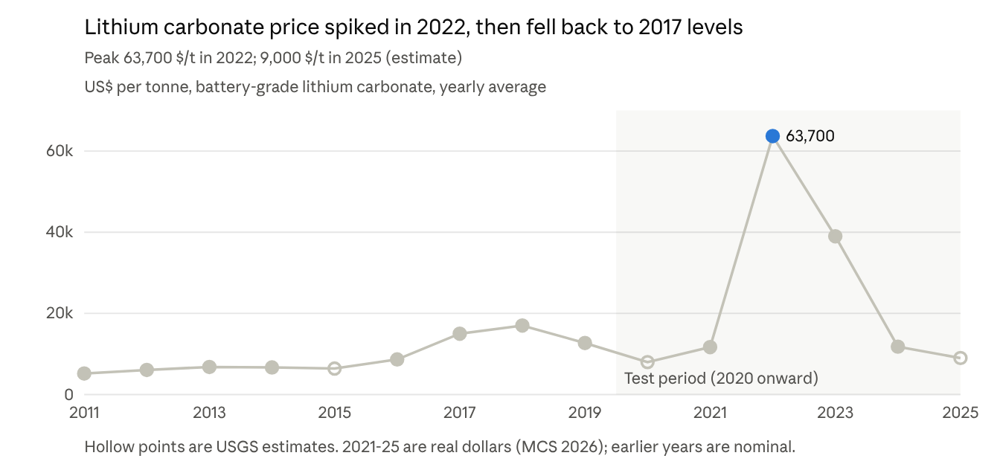

# Mining Claims Prediction — Data Sources Report

24 Oct 2026, Arjin. This removes the Nevada claim-date blocker in [the land-buy plan](lodestar-land-buy.md) and [the LODESTAR data check](lodestar-data-check.md): NDOM publishes BLM claims **with location and closed dates**, and all 2.4M NV + AZ records are downloaded and verified. Download script: [nv-az-claims/download_claims.py](nv-az-claims/download_claims.py). What still needs finding: [nv-az-data-to-find.md](nv-az-data-to-find.md).

## TL;DR

We have enough free data to build the model. The one dataset that makes it possible is NDOM's historic claims layer. The BLM files named in the brief have no dates.

| Use for | Dataset | Status |
| --- | --- | --- |
| Target: new claims per cell per year | NDOM "All States Historic Claims" + current NV/AZ claim layers | Tested, downloading |
| Which claims are lithium | NDOM inferred lithium placer claims (24,416) | Tested |
| Distance to known deposits | USGS MRDS (all commodities incl. gold, copper) | Downloaded |
| Distance to mines and prospects | USGS USMIN topo mine symbols (NV, AZ) | Downloaded |
| Lithium deposits | USGS critical-mineral deposits (lithium layer) | Downloaded |
| Magnetic anomaly | USGS North America magnetic grid (1 km); GeoDAWN high-res over Clayton Valley | Links checked |
| Spectral / alteration | USGS ASTER alteration map (SW US); NASA EMIT minerals | Links checked, manual download |
| Copper and gold prices | World Bank Pink Sheet, monthly 1960 to Sep 2026 | Downloaded |
| Lithium prices | USGS Mineral Commodity Summaries, yearly 2011–2025 | Downloaded (PDFs) |
| Rock type | USGS State Geologic Map Compilation | Manual download |
| Validation case | Thacker Pass and Clayton Valley (flagged first, confirmed by drilling) | Sourced |

All datasets were checked by downloading or querying them on 24 Oct 2026.

## Claims history (what we predict)

Use the NDOM historic layer for 1850 to early 2025, and the current NV/AZ layers for 2025–26. Skip the BLM national layers except for their quality score.

| Dataset | Rows (NV + AZ) | Dates? | Notes |
| --- | --- | --- | --- |
| [NDOM All States Historic Claims](https://services.arcgis.com/CXYUMoYknZtf5Qr3/arcgis/rest/services/AllStatesHistoricClaimsFeeCalculationNoDuplicatesFeesAGOL03212022/FeatureServer/29) | 2,408,736 | Location_Date on every row; Closed_Date on nearly all closed rows | Snapshot 19 Mar 2025. Points at section level (MTRS) plus quarter-section text. Has Claim_Type (lode / placer / mill site / tunnel). |
| [NDOM Nevada current claims](https://services.arcgis.com/CXYUMoYknZtf5Qr3/arcgis/rest/services/ArcOnlineNvStateClaims/FeatureServer/1) | 644,851 | LocDate | Active, pending, filed. Updated Oct 2026. Covers new 2025–26 claims. |
| [BLM Arizona current claims](https://services5.arcgis.com/aEZWbbQHTw7fmHLY/arcgis/rest/services/ArizonaMiningClaims/FeatureServer/19) | 149,874 | LocDate | Active. Updated Oct 2026. Already downloaded. |
| [BLM MLRS Not Closed](https://gbp-blm-egis.hub.arcgis.com/datasets/BLM-EGIS::blm-natl-mlrs-mining-claims-not-closed) | 594,243 (national) | No | Has QLTY (mapping quality score). Join on serial number to filter bad locations. |
| [BLM MLRS Closed](https://gbp-blm-egis.hub.arcgis.com/datasets/BLM-EGIS::blm-natl-mlrs-mining-claims-closed) | 78,610 (national) | No | Only claims closed in the past year. Not usable for history. |

Breakdown of the historic layer:

| State | Active | Closed | Filed / submitted / under review | Earliest–latest location date |
| --- | --- | --- | --- | --- |
| NV | 311,128 | 1,434,831 | 52,659 | 1850 – Mar 2025 |
| AZ | 73,499 | 533,655 | 2,964 | 1872 – Mar 2025 |

The `gis.blm.gov` FeatureServer URLs in the brief now redirect to a server that refuses requests (token required / 503).

## Where minerals are (deposits, mines, districts)

MRDS is the main "known deposits" layer for gold and copper. For lithium, the NDOM inferred-lithium claims layer is more useful than any deposit list.

| Dataset | NV | AZ | What it gives us |
| --- | --- | --- | --- |
| [USGS MRDS](https://mrdata.usgs.gov/mrds/) | 15,408 sites (gold 7,787; copper 3,536; lithium 16) | 12,942 sites (gold 5,112; copper 5,243; lithium 37) | Distance to known deposits by commodity. Frozen since 2011, with duplicates. |
| [USGS USMIN topo mine symbols](https://mrdata.usgs.gov/usmin/) | 121,193 points | 43,741 points | Shafts, adits, pits, prospects. No commodity field, so it measures mining activity in general. |
| [USGS critical-mineral deposits (lithium)](https://mrdata.usgs.gov/uscritmin/) | 8 lithium deposits | 4 lithium deposits | Named lithium deposits. Copper isn't in this dataset. |
| [NDOM inferred lithium placer claims](https://services.arcgis.com/CXYUMoYknZtf5Qr3/arcgis/rest/services/NVLithiumClaims/FeatureServer) | 24,416 claims (20,523 active, 3,893 filed), with location dates | — | NDOM's own "this placer claim is for lithium" label. This solves the "claims don't say the mineral" problem for Nevada. |
| [NBMG mining districts](https://gisweb.unr.edu/nbmg/rest/services/MineralsAndEnergy/mining_districts/MapServer) | 535 districts | — | District polygons with names |
| [AZGS mining districts](https://services1.arcgis.com/Ezk9fcjSUkeadg6u/arcgis/rest/services/AZGS_Mining_Districts_WFL1/FeatureServer) | — | 287 districts, 180 list copper | Labels Arizona claims as copper by district |
| [Arizona active mines (AZGS)](https://services1.arcgis.com/Ezk9fcjSUkeadg6u/arcgis/rest/services/Arizona_Active_Mines/FeatureServer) | — | 381 mines and plants | Distance to producing mines. Last updated 2019. |

The NDOM lithium layer only holds active and filed claims, not closed ones. For the 2025–26 drop we'll still need the historic layer, labelled by basin.

## Prices

We have yearly lithium prices for 2011–2025 and monthly copper and gold prices back to 1960. The lithium series has the boom and bust our test period has to catch.

*Source: USGS Mineral Commodity Summaries 2016, 2021 and 2026, lithium sheets.*

| Series | Source | Coverage | Latest value |
| --- | --- | --- | --- |
| Copper, monthly | [World Bank Pink Sheet](https://www.worldbank.org/en/research/commodity-markets) | Jan 1960 – Sep 2026 | 14,474 $/t (about 6.57 $/lb), Sep 2026 |
| Gold, monthly | World Bank Pink Sheet | Jan 1960 – Sep 2026 | 4,319 $/troy oz, Sep 2026 |
| Lithium carbonate, yearly | USGS MCS [2016](https://d9-wret.s3.us-west-2.amazonaws.com/assets/palladium/production/mineral-pubs/lithium/mcs-2016-lithi.pdf), [2021](https://pubs.usgs.gov/periodicals/mcs2021/mcs2021-lithium.pdf), [2026](https://pubs.usgs.gov/periodicals/mcs2026/mcs2026-lithium.pdf) | 2011 – 2025 | 9,000 $/t, 2025 estimate |

The copper break-even prices in the brief, Bagdad at about $4.00/lb and Gunnison at $4.60/lb, haven't been checked against the filings yet. Copper is currently well above both.

Two caveats on lithium. 2010 is missing. The 2026 edition reports real dollars while older editions are nominal. The MCS 2026 CSV is on ScienceBase, which blocks scripted downloads, so these numbers were read from the PDFs.

## Magnetic and spectral imaging

Use the national magnetic grid plus the ASTER mineral map as cell features for both states, and GeoDAWN for detail around Clayton Valley. All of these are one snapshot in time. They tell us **where** lithium or copper is likely, while claims and prices tell us **when**.

| Data | Type | Covers | Resolution / size | Download | Use in model |
| --- | --- | --- | --- | --- | --- |
| [North America magnetic anomaly map (USGS)](https://mrdata.usgs.gov/magnetic/) | Aeromagnetic grid, surveys 1945–2001 | All of NV and AZ | 1 km grid; `USmag_CM.zip` 48.6 MB | Direct, no login | Magnetic anomaly per cell (buried intrusions, porphyry copper) |
| [USGS radiometric map](https://mrdata.usgs.gov/radiometric/) | Gamma-ray K, Th, U grids | All of NV and AZ | `NAMrad_K/Th/U.zip` | Direct, no login | Potassium and uranium, tied to alteration and volcanic ash (lithium clays) |
| [USGS gravity (Bouguer)](https://mrdata.usgs.gov/gravity/) | Gravity grid | All of NV and AZ | `US_bouguer.zip` | Direct, no login | Gravity lows mark deep basins (lithium brine traps) |
| [GeoDAWN (USGS Earth MRI)](https://data.usgs.gov/datacatalog/data/USGS:657e1d85d34e23d3533209f7) | High-res airborne magnetics + radiometrics, flown Nov 2021–Nov 2022 | NW Great Basin; Area 1 centred on Clayton Valley | Flight lines + grids; [doi 10.5066/P93LGLVQ](https://doi.org/10.5066/P93LGLVQ) | ScienceBase (may block scripts, download by hand) | Detailed check around the confirmed lithium sites |
| [Eastern Great Basin survey (Earth MRI)](https://www.usgs.gov/data/airborne-magnetic-and-radiometric-survey-over-a-part-eastern-great-basin-nevada-2024-2025) | Airborne magnetics + radiometrics, Aug 2024–May 2025 | East-central NV (Ely, Eureka) | 126,000 line-km; radiometrics at [doi 10.5066/P13VSMZ3](https://doi.org/10.5066/P13VSMZ3) | ScienceBase | Optional, outside the main lithium areas |
| [Arizona aeromagnetic + gravity (USGS OFR 01-81)](https://pubs.usgs.gov/publication/ofr0181) | State compilation | All of AZ | Grid `az1000ag` | Old FTP links, untested | Sharper AZ copper features than the national grid |
| [ASTER hydrothermal alteration map (USGS)](https://data.usgs.gov/datacatalog/data/USGS:58daaa60e4b0543bf7fdaafa) | Satellite spectral mineral groups (clays, alteration types) | SW US incl. NV and AZ | ERDAS .img; [doi 10.5066/F7CR5RK7](https://doi.org/10.5066/F7CR5RK7) | ScienceBase | Best ready-made spectral feature: argillic / phyllic alteration for copper, clay for lithium |
| [NASA EMIT L2B minerals](https://www.earthdata.nasa.gov/data/catalog/lpcloud-emitl2bmin-002) | Satellite hyperspectral, from 2022 | Patchy scenes, 60 m | NetCDF, raw (not orthorectified) | Free Earthdata login | Montmorillonite, illite, kaolinite maps. NASA says exploration use needs more validation. |
| [GEMx MASTER / AVIRIS (NASA + USGS)](https://daac.ornl.gov/cgi-bin/dsviewer.pl?ds_id=2370) | Airborne hyperspectral, 2023–25 | Flight strips in NV, AZ, CA, OR | Level 1B radiance only so far | Earthdata login | Too raw for this weekend. Skip unless Level 2 mineral maps appear. |

No dataset maps lithium directly. Clay minerals and volcanic-ash signals are indirect hints, so we present them as "likelihood", not proof.

## Geology (rock type)

Use the USGS State Geologic Map Compilation (SGMC) for a "rock type" feature per cell. It needs a manual download.

| Dataset | Covers | Field to use | Access |
| --- | --- | --- | --- |
| [SGMC 2026 update](https://doi.org/10.5066/P1A3DQZK) | All 48 states, 1:50k–1:1M state maps | Generalised lithology (check the field name in the new version) | ScienceBase, download by hand |
| [SGMC v1.1 (2017)](https://www.usgs.gov/data/state-geologic-map-compilation-sgmc-geodatabase-conterminous-united-states) | Same | `GENERALIZED_LITH` | ScienceBase, download by hand |

Units aren't matched across the NV/AZ border, which is fine because we model each state separately. The USGS energy-server copy of SGMC returned "layer not found" when tested.

## Confirmed lithium cases (predicted, then proven)

Thacker Pass is the strongest "flagged first, confirmed later" case. Clayton Valley claystone is the best match for our 2016–2024 test window.

| Site | Flagged | Confirmed | Proof | Source |
| --- | --- | --- | --- | --- |
| Thacker Pass, McDermitt caldera (Humboldt Co., NV) | 1975–79: Chevron's uranium program; Chevron "was alerted to the presence of anomalous concentrations of lithium" | 1978–79 clay assays confirmed high lithium; drilling 1980–87; 77 holes in 2017 | Dec 2017 estimate: 385 Mt Measured + Indicated at 2,917 ppm Li (5.98 Mt LCE) | [Lithium Americas 2018 technical report (SEC)](https://www.sec.gov/Archives/edgar/data/0001440972/000156459018019846/lac-ex991_16.htm) |
| Dean & Glory claystone, Clayton Valley (Esmeralda Co., NV) | Jan 2016 surface sampling, several assays above 2,000 ppm Li | 2017 drill program over a 7 km trend | May 2020 prefeasibility: 222 Mt Probable Reserve at 1,141 ppm Li (1.35 Mt LCE) | [Resource World on the PFS](https://resourceworld.com/?p=58395) |

How we use them:

- **Backtest check:** the NDOM lithium-claims layer (24,416 claims, mostly Esmeralda and Nye) should show claim bursts in these cells around 2016–18, before the reserve was published. If the model flags these cells early, that's our demo story.
- **Ground truth for geophysics:** USGS GeoDAWN flew magnetics and radiometrics centred on Clayton Valley, chosen for its lithium clay and brine (see Magnetic and spectral imaging). We can check whether confirmed cells look different in that data.

Open question: the exact date Cypress staked Dean & Glory. The claim records should tell us once the download finishes.

## Problems and how we handle them

| Problem | How we handle it |
| --- | --- |
| BLM claim files have no location or closed dates | Use the NDOM historic layer, which has both |
| Historic layer stops at Mar 2025 | Claims active in Mar 2025 but missing from the Oct 2026 current layers have closed since. That gives us the 2025–26 drop. |
| Claims don't say which mineral | NV lithium: NDOM's inferred-lithium layer plus placer claims in known brine/clay basins. AZ copper: AZGS copper districts plus distance to MRDS copper. NV gold: distance to MRDS gold. Written down as an assumption. |
| No mapping-quality field in NDOM data | Keep claims with a quarter-section given; optionally join BLM's QLTY score by serial number |
| MRDS is old (2011) and has duplicates | Use it only as "minerals found here historically" |
| ScienceBase and usgs.gov block scripted downloads | Download GeoDAWN, ASTER, SGMC and the MCS CSV by hand in a browser |
| Magnetic and spectral data are one snapshot | Use them as "where" features, never as a time signal |
| Lithium price: 2010 missing; real vs nominal dollars mixed | Start lithium features in 2011; convert all years to one basis |
| Claims are not mines | We predict land-staking demand, not discoveries |

**Teammate's gold dataset:** we still need to know what it is. If it's gold prices, the World Bank series already covers 1960–2026 monthly, so use whichever is cleaner. If it's deposits, mines or production, it adds to MRDS gold.

## Next steps

- [ ] Finish the claims download (2.4M historic rows + 645k NV current), then write DATA_CHECK.md
- [ ] Someone downloads by hand: GeoDAWN, ASTER SW alteration map, SGMC, MCS 2026 CSV
- [ ] Script downloads: national magnetic (`USmag_CM.zip`), radiometric K/Th/U, gravity, NDOM lithium claims
- [ ] Share the teammate's gold dataset so we can see how it fits
- [ ] Check the Bagdad and Gunnison break-even prices against the filings
- [ ] Look up when the Dean & Glory claims were staked (Clayton Valley validation case)
