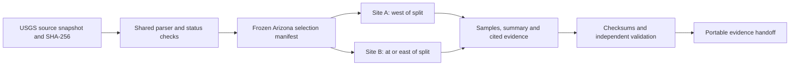

# Shared soil-evidence method for Amit and Arjin

Owner: Amit, common extraction method and Site A. Arjin owns Site B's pack and interpretation. Muhd consumes the evidence; Salman consumes explicit measured-data fields and separately defined scenario assumptions. MiroFish setup, prompts and execution are outside this utility.

## Engineering scheme

The development loop is implementation, unit tests, an independent raw-source/implementation review, correction, and a clean rerun. Codex coordinates the work; the evidence calculations themselves are deterministic Python, not model-generated judgments. No graph database, application framework or new package is needed.



`provenance.json` records the derivation links within a pack. Source checksum, sample IDs and summary references connect each result to its inputs. `validation.json` records checks and hashes of every other output file. It excludes itself to avoid a recursive checksum. This is an auditable provenance graph, not a knowledge-graph prediction model.

## Source and fixed selection

Use USGS Data Series 801, C-horizon table `Appendix_4b_Chorizon_18Sept2013.txt`. Source SHA-256:

```text
4aa8080f81f690587f762300bada16e33e376eea0003243d5333b47c78b4c90c
```

The [source table](https://pubs.usgs.gov/ds/801/downloads/Appendix_4b_Chorizon_18Sept2013.txt) and [report](https://pubs.usgs.gov/ds/801/) identify the data. The existing downloaded source and metadata are also provided in the local handoff archive. Public access can change; a different downloaded file is not silently substituted for this snapshot.

The committed [selection manifest](site-evidence-selection.json) uses all 177 `StateID=AZ` records, including missing copper. The median longitude is **-111.5453**. A is west of that value; B includes the value and everything east of it. A has 88 records and B has 89. This rule was frozen from coordinates before Site A summaries were calculated. The manifest stores the included IDs and sample-coordinate bounding boxes. Those boxes are not legal parcels or geological boundaries.

The parser validates the expected source checksum, field layout and quality counts. It preserves original values and identifiers. This is a historical soil survey, not current drilling or land-title information. Variable `C_Depth` strings remain as reported, including unknown depth. Source collection dates are not publication dates.

## Reproduce either area

Run from the repository root using Python 3 and its standard library. Put the exact source file at the shown ignored path, or substitute its actual path with `--source`. No dependency installation is required.

```sh
python3 scripts/soil_evidence.py \
  --source data/raw/us-soil/Appendix_4b_Chorizon_18Sept2013.txt \
  --selection research/site-evidence-selection.json \
  --area A \
  --output data/generated/us-soil/site-a
```

Arjin uses the same source and manifest, changing only area and output:

```sh
python3 scripts/soil_evidence.py \
  --source data/raw/us-soil/Appendix_4b_Chorizon_18Sept2013.txt \
  --selection research/site-evidence-selection.json \
  --area B \
  --output data/generated/us-soil/site-b
```

An identical output directory may be reused. A non-identical existing directory is refused; use a new output path to preserve previous work.

Run the extractor tests with:

```sh
python3 -m unittest discover -s tests -p 'test_soil_evidence.py' -v
```

## Output and interpretation contract

| File | Consumer and meaning |
|---|---|
| `samples.csv` | Row-level evidence with original source IDs, coordinates, date/depth, raw copper and parsed status; suitable for both team members' tools |
| `site.json` | Area/source identity and extraction metadata |
| `summary.json` | Descriptive measurements and their denominators, not mineral probabilities |
| `evidence.md` | Briefing for Muhd and the team, with source-record and summary references |
| `assumptions.json` | Empty assumptions plus unresolved scenario inputs for Salman; no fabricated success probability or economic value |
| `README.md` | Interpretation and regeneration instructions |
| `selection.json` | Copy of the common frozen selection manifest |
| `provenance.json` | Derivation graph and source/sample references |
| `validation.json` | Validation results and non-self output checksums |

The row-level columns are `study_area_id`, `source_id`, `sample_id`, `lab_id`, `state`, `latitude`, `longitude`, `collection_date_raw`, `collection_date`, `depth_raw_cm`, `copper_raw`, `copper_mg_kg`, `copper_status`, `detection_limit_mg_kg` and `copper_unit`. Numeric nulls are empty CSV fields. Salman can consume `summary.json` through its `record_count`, `status_counts`, `copper`, `collection_dates`, `depth_raw_cm_counts` and `sample_ids` keys; `copper.denominator` is the quantified subset size.

Copper units are mg/kg. Numeric values are quantified measurements; `<0.5` is below detection, not zero. `N.S.` means no sample and `INS` insufficient sample. Unknown concentration remains null. Summary concentration statistics use quantified rows only and disclose the denominator. The missing Site A record stays in the inventory. Quartiles use the inclusive convention.

High recorded soil values are observations, not discoveries. The pack does not estimate a deposit, grade at drilling depth, economic extraction value or a chance of profitable investigation. Those interpretations and simulated inputs require separate, visible assumptions.

## Team handoff

Raw data and generated packs are ignored by Git. Pulling this branch supplies the extractor, tests, manifest and documentation, not the data files. Use the prepared source-and-method archive, or transfer the exact source snapshot separately and verify its checksum.

Amit's Site A pack can be shared as its own archive. Arjin should generate B with the command above and write his own interpretation using the same evidence contract. File transfer is a human/team handoff; this utility does not send messages, upload files or contact external services.

Before using the pack, verify `validation.json` hashes, inspect the missingness denominator and trace one ordinary and one high-value record back to the source. Baseline quality counts are 4,857 national rows and 177 Arizona rows. Reproducibility and correct parsing establish evidence integrity, not predictive accuracy.
