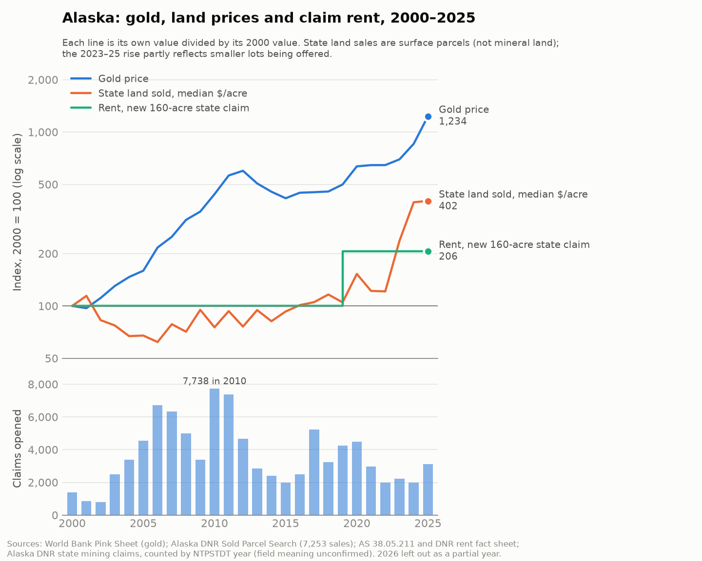

# Alaska land costs by year

25 October 2026. Owner: Arjin. The team asked for yearly land costs in Alaska to compare land value with transactions. No published series gives the yearly price of mineral land at Tok. This page lines up the yearly series that do exist, side by side, from official sources.

| Series | What it measures | Where | File |
|---|---|---|---|
| State claim rent | What the state charges each year to **hold** a mining claim | All Alaska state land, including the Tok sites | [alaska_holding_costs_by_year.csv](alaska_holding_costs_by_year.csv) |
| BLM fee | What the federal government charges each year per **federal** claim | Federal land in all states; it does not apply to the Tok state claims | same file |
| State land sales | What people actually **paid** for state-owned land, per acre | Alaska, statewide and by DNR region | [alaska_land_sales_by_year.csv](alaska_land_sales_by_year.csv) |
| Gold price and claims opened | Market background | Alaska-wide claims; World Bank gold price | [alaska_claims_vs_gold.csv](alaska_claims_vs_gold.csv) |
| Mineral deals | Prices paid for mineral claims and projects | Alaska | [gold_deal_comparables.csv](gold_deal_comparables.csv) |

**The state land sales are surface parcels** (homesites, cabins, recreation), not mineral land. They give the floor value of land with no mineral value counted, the "surface floor" in Salman's design. They are not a price for mining claims.

Since 2000, gold rose about 12-fold (index 1,234). The median price of state land sold rose about 4-fold (402), and the rent for a new claim about 2-fold (206), in one step in 2019. Claim staking peaked in 2010 and has not tracked gold's recent rise. The chart is drawn by [plot_land_costs.py](plot_land_costs.py), which needs matplotlib; the numbers are in the table below.

## Side by side, 2000–2026

| Year | Gold, US$/oz | AK claims opened | AK rent, new 160-acre claim | BLM fee per claim | AK state land sold: median $/acre (parcels) | Richardson/Alaska Hwy region: median $/acre (parcels) |
|---|---:|---:|---:|---:|---:|---:|
| 2000 | 279 | 1,394 | $80 | $100 | 1,714 (73) | 1,300 (3) |
| 2001 | 271 | 861 | $80 | $100 | 1,958 (125) | 1,400 (18) |
| 2002 | 310 | 791 | $80 | $100 | 1,420 (513) | 749 (128) |
| 2003 | 364 | 2,503 | $80 | $100 | 1,323 (583) | 1,928 (66) |
| 2004 | 409 | 3,374 | $80 | not verified | 1,150 (435) | 1,799 (36) |
| 2005 | 445 | 4,553 | $80 | not verified | 1,158 (400) | 981 (25) |
| 2006 | 604 | 6,731 | $80 | not verified | 1,063 (435) | 2,405 (16) |
| 2007 | 697 | 6,327 | $80 | not verified | 1,346 (492) | 1,300 (21) |
| 2008 | 872 | 4,993 | $80 | not verified | 1,218 (400) | 1,132 (24) |
| 2009 | 973 | 3,382 | $80 | $140 | 1,627 (237) | 3,572 (2) |
| 2010 | 1,225 | 7,738 | $80 | $140 | 1,291 (212) | 1,298 (10) |
| 2011 | 1,569 | 7,378 | $80 | $140 | 1,600 (233) | 1,123 (8) |
| 2012 | 1,670 | 4,651 | $80 | $140 | 1,304 (226) | – |
| 2013 | 1,412 | 2,855 | $80 | $140 | 1,622 (223) | 3,250 (3) |
| 2014 | 1,266 | 2,402 | $80 | $155 | 1,400 (246) | 1,098 (7) |
| 2015 | 1,161 | 1,972 | $80 | $155 | 1,592 (297) | 1,481 (16) |
| 2016 | 1,249 | 2,485 | $80 | $155 | 1,733 (276) | 1,424 (34) |
| 2017 | 1,258 | 5,222 | $80 | $155 | 1,802 (237) | 1,435 (26) |
| 2018 | 1,269 | 3,237 | $80 | $155 | 1,994 (180) | 1,358 (11) |
| 2019 | 1,393 | 4,234 | $165 | $165 | 1,797 (212) | 1,361 (18) |
| 2020 | 1,770 | 4,489 | $165 | $165 | 2,618 (177) | 1,629 (14) |
| 2021 | 1,800 | 2,957 | $165 | $165 | 2,091 (204) | 2,004 (12) |
| 2022 | 1,801 | 1,996 | $165 | $165 | 2,077 (170) | – |
| 2023 | 1,943 | 2,225 | $165 | $165 | 4,062 (165) | 2,500 (1) |
| 2024 | 2,388 | 1,989 | $165 | $200 | 6,761 (147) | 2,427 (2) |
| 2025 | 3,442 | 3,113 | $165 | $200 | 6,886 (109) | 8,503 (1) |
| 2026 | 4,552 | 1,582 | $165 | $200 | 2,894 (98) | – |

A rent or fee shown against a year is the amount due in the mining year that starts on 1 September of that year. Rent rises with claim age. The table shows the first-years rate; [the CSV](alaska_holding_costs_by_year.csv) has all age bands.

## What it shows

- **Holding a claim is cheap and rose in steps.**
  - The rent for a new 160-acre state claim was $80 a year from 2000. In the 2020 mining year, which started 1 September 2019, it roughly doubled to $165, about $1 per acre per year.
  - The rent was set by statute in 1989 and 2000 and revised by regulation in 2019.
- **Ordinary state land sold for about $1,000–2,000 per acre (median) from 2000 to 2019.**
  - The median then rose to about $4,000–6,900 in 2023–2025.
  - That rise partly reflects which parcels were offered: fewer and smaller lots. It is not a like-for-like price index.
- **Mineral claim packages sell for much less per acre than surface lots.** Avidian (2024) is about $176–205 per acre and US Antimony (2025) about $168 per acre, from the deal table.
  - Those are large, remote claim blocks. The surface parcels are small, roaded lots.
  - So the per-acre gap mostly reflects parcel size and access, not mineral value. Compare like with like.
- **The Tok-area region has too few sales to use on its own** after 2019: 0–2 parcels a year. Use the statewide figures, or pool several years.

## How it was built

- **Rent and fees:** `python3 research/tok-land/holding_costs_by_year.py`.
  - Every rate comes from a cited schedule in the script: the 1989 and 2000 Alaska session laws, the DNR Annual Rent fact sheet (11 AAC 86.221), and the Federal Register for the BLM fee.
  - Years with no verified rate are blank. Nothing is interpolated.
- **Land sales:** `python3 research/tok-land/land_costs_by_year.py`.
  - It sends the same request as DNR's [Sold Parcel Search](https://dnr.alaska.gov/mlw/landsales/history/sold-parcel-search/), once per auction and once per auction and region (about 770 requests, about 20 minutes on a first run). It caches them in `data/raw/tok-land/land-sales/`, which Git ignores.
  - It keeps sold, non-withdrawn parcels with a price, acreage and sale date: 7,253 parcels, 1996–2026.
  - Medians and quartiles are by calendar year of sale.
  - A rerun from the cache gives an identical CSV.
- **Check against DNR press releases**, counting parcels sold on auction day:
  - 2025 (auction 497): 99, exactly as reported
  - 2024 (auction 496): 118 vs 121 reported
  - 2023 (auction 495): 134 vs 136 reported
  - Parcels left over at an auction and sold later over the counter carry the same auction number: 29 for 2024, 31 for 2023.
  - The small remaining gaps are probably auction winners who did not complete the purchase. That is not verified.

## Limits

- **No series is a price for mineral land at Tok.** The deal table is the only mineral price evidence, and it is thin.
- **Surface sales mix parcel types and sizes, and the mix changes by year.** The median is descriptive, not a quality-adjusted index.
- **2026 is a partial year.** It includes auction 498, opened 21 October 2026.
- **Over-the-counter sales are included** alongside auction sales. The search does not label them separately.
- **The BLM fee for 2004–2008 is left blank.** The $125 rule of 2004 was rolled back by PL 108-447, and its later restoration is not verified here.
- **Annual labour is a separate obligation.** It is $100 per 40-acre or $400 per 160-acre claim under the 2000 law, payable in cash instead of work. It is not in the rent columns, and later changes to it were not checked.
- **Prices are nominal**, not adjusted for inflation.

## Sources

- Alaska session laws: [1989 ch. 101](https://www.akleg.gov/pdf/16/Bills/Final/CH%20101%20SLA%201989.pdf), [2000 ch. 74](https://www.akleg.gov/pdf/21/Bills/final/CH%2074%20SLA%202000.pdf).
- DNR [Fact Sheet: Annual Rent (July 2021)](https://dnr.alaska.gov/mlw/cdn/pdf/factsheets/annual-rent.pdf).
- BLM fee rules: [69 FR 40294 (2004)](https://www.federalregister.gov/documents/2004/07/01/04-15158/location-recording-and-maintenance-of-mining-claims-or-sites), [74 FR 30959 (2009)](https://www.federalregister.gov/citation/74-FR-30959), [79 FR 36662 (2014)](https://regulations.justia.com/regulations/fedreg/2014/06/30/2014-15259.html), [84 FR 31219 (2019)](https://regulations.justia.com/regulations/fedreg/2019/07/01/2019-13963.html), [2024-14301 (2024)](https://www.federalregister.gov/documents/2024/07/01/2024-14301/required-fees-for-mining-claims-or-sites).
- DNR land sales: [Sold Parcel Search](https://dnr.alaska.gov/mlw/landsales/history/sold-parcel-search/); press releases for auctions [495](https://dnr.alaska.gov/commis/pic/releases/10.31.2023%20Auction%20Puts%20136%20Lots%20of%20Alaskan%20Land%20in%20Alaskan%20Hands.pdf), [496](https://dnr.alaska.gov/commis/pic/releases/11.6.2024%20Auction%20Puts%20121%20Lots%20of%20Alaskan%20Land%20in%20Alaskan%20Hands.pdf) and [497](https://dnr.alaska.gov/commis/pic/releases/10.31.2025%20Land%20Auction%20Puts%2099%20Lots%20Into%20Alaskans'%20Hands.pdf).
