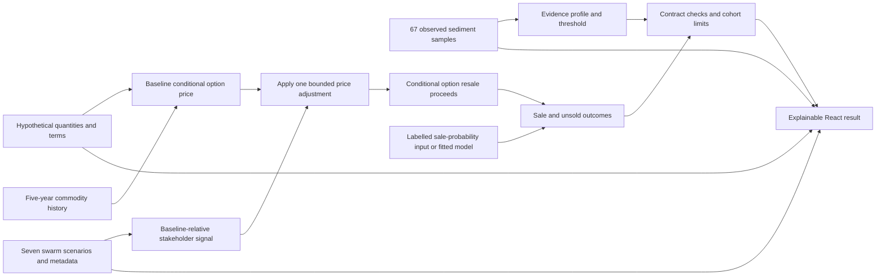

# Tok option strategy and model build plan

25 October 2026, consolidating the 24 October discussion. **Current local hackathon design.** This consolidates the accepted decisions in [the intake record](predictive-model-intake.md). Later decisions in that record supersede earlier proposals. Success for the hackathon means a complete, explainable prototype. Evidence that it predicts later market outcomes better than a baseline is a subsequent goal.

Use this document for the new prototype. The [earlier combined strategy in PR 24](https://github.com/amitvijapur/oxhack-2026/pull/24) remains a research reference; its five-day purchase/exercise fixture is not the selected 90-day option-assignment model. This implementation is published separately and does not merge a teammate's work.

Implementation update, 25 October 2026: the local executable prototype is now in [model/tok-option](../model/tok-option/README.md), with the React workbench and [verification results](../model/tok-option/VERIFICATION.md). The sections below preserve the agreed specification and original consolidation boundary. Actual swarm exports and real market inputs remain pending.

## Current lot and capital amendment

Amit selected a provisional US$30,000 whole-contract initial-payment reference
from the regional pricing workup and requested platform-wide consistency. The
active demo adds a separate assumed US$50 entry fee and US$50 exit fee. Its
US$1,502,500 fund preserves 2% per-option and 10% open/cohort ratios, with five
indivisible positions. The original US$100k/US$2k/US$10k limits below are historical
intake decisions, superseded by this amendment.

The historical signing-payment reference excludes substantial other obligations
and supplies no assignment forecast. The initial entry-only update left the
old 500oz/US$4k exposure unchanged and produced an inappropriate active demo
comparison. Amit rejected that result and requires local review of its correction
before any further publication.

The proposed local profile scales both invented quantity and buyer consideration
by 30,000/650 once, then freezes them. It is one synthetic interest, not a bundle
of tradable old contracts. Its US$69,230.77 assignment and 12.35% 90-day expected
return depend on fixed US$50 fees; proportional reference fees preserve 1.09%
and fail the current cap. The 25% target hurdle remains separately solved at
US$77,022.34. See the [local result review](orecast-contract-pricing/consistent-lot-review.md).

## Current implementation amendment, gold forecast v2

The user requested completion of the missing swarm-to-gold layer. The canonical engine now applies the weighted support contrast to a hypothetical gold-price forecast, then recomputes mineral-interest and option values before sale-weighted cash. The previous direct option-price markup is superseded. The 7% default now bounds an editable gold response; it does not cap the option movement. This is an uncalibrated hackathon relationship, not a measured predictive edge. See [the current equations and examples](../model/tok-option/README.md). Older discussion below records the original specification.

## What we are building

An interactive prototype for a simulated fund considering an **assignable option over a specified Tok/Alaska mineral interest**. The intended trade is to acquire the option and sell that option before expiry, without exercising it or operating a mine. No actual available option, buyer, executable quote or liability release has been verified.

The model combines a property's geological evidence profile, hypothetical material quantities and historical commodity growth with seven news-conditioned stakeholder simulations. It produces a conditional option resale-price estimate and makes the assumptions behind that estimate inspectable. Sale probability is a separate desired output, with an explicit unavailable state until supplied by a labelled illustrative assumption or a defensible fitted model. Position selection then respects contract terms and a fixed simulation budget.

The edge hypothesis is that news reactions and their interaction with particular geological properties may anticipate repricing. It is not yet evidence of mispricing, predictive skill or a feasible trade. The connection to **TIME** is explicit: five-year history, information availability, changing stakeholder reactions, option expiry, and possible assignment over 30, 90 and 180 days.

## Confirmed choices and editable defaults

| Topic | Current decision | Status |
| --- | --- | --- |
| Initial market | Tok/Alaska | User selected |
| Instrument and exit | Acquire an assignable mineral-interest option; resell before expiry; no exercise or mining | User selected; real contract pending |
| Primary output | Option assignment proceeds conditional on a completed sale | User selected |
| Liquidity output | Probability of sale and time to sale, including unsold cases | User selected; no calibrated model available |
| Horizon | Working 90 days; compare 30 and 180 days | User accepted research assumption |
| Historical lookback | Approximately five years of relevant commodity/property history | User selected; monetary sources pending |
| Geological evidence | Current 67 Tok stream-sediment samples; expansion optional | User selected |
| Geology layers | A: observed profile; B: desired deposit-likelihood layer; C: hypothetical quantities | User selected; B's event/labels unresolved |
| Other materials | Gold indicators and additional economic value where justified | User selected roles; evidence required per material |
| Prototype method | Configurable hard threshold and hypothetical material exposure, grown over the chosen horizon | User selected simplification |
| Scenarios | Baseline, mine approval, proposed tax, protest, sports placebo, mine blocked, gold reversal | User confirmed intended running set |
| Stakeholders | Industry and funds weighted more heavily; government, community and retail modify the result | User selected policy; numerical weights proposed separately |
| Swarm price effect | Maximum positive or negative adjustment of 7% | User selected adjustable assumption |
| Capital limits | USD100,000 starting fund; USD2,000 at risk per option; USD10,000 open risk; at most five positions | Editable prototype defaults from intake |
| Cohort policy | USD10,000 maximum committed across the whole run; no reinvestment after exits; no borrowing or automatic exercise | First-demo scope/default |
| Hackathon success | Complete and explainable prototype; predictive validation later | User selected |

The monetary limits do not imply that Tok options are available at those prices. The 7% scenario cap limits one model adjustment, not investment losses. Numerical thresholds, group weights, material quantities, baseline option values and any sale probabilities must retain their assumption labels.

## What exists, what is assumed, and what is pending

**Observed or inspected locally.** The React/Vite/MapLibre evidence site displays 67 historical sediment samples. Its compact snapshot contains primary gold measurements, a separate gold retest and lithium. A and B contain 33 and 34 samples respectively and are longitude-defined comparison areas, not verified properties, parcels or option interests. A and B have quantified-primary-gold medians of 0.013 and 0.008 ppm, each from 33 quantified results. One B result is above detection at greater than 1 ppm; its 1.1 ppm retest stays a separate measurement. Lithium medians are 31.6 and 21 ppm. These summaries describe the sample data, not recoverable quantities or mineral-interest values.

**Explicitly assumed for the prototype.** Hypothetical option terms, material quantities, economic anchors, threshold choices, weights, sensitivity bounds and any illustrative selling policy. These may support a runnable demonstration with a reproducible fixture. They must never be presented as observed market prices, resources/reserves or calibrated probabilities.

**Pending handoffs.** Actual swarm outputs and metadata have not been inspected. Tok/Alaska price and assignment histories, unsold records, real option terms, executable offers and deposit outcome labels are absent. The existing heterogeneous Nevada/Arizona agreement catalogue is background research, not a Tok assignment-price training set.

Lithium is not established here as a gold indicator. Additional material fields are an extension point only after real data and a justified role arrive. Do not fabricate multi-element observations or infer recoverable ounces from sediment concentrations. The desired deposit-likelihood layer can remain unavailable while the observed profile and hypothetical quantity layer support the hackathon demonstration.

## End-to-end pipeline



An unavailable upstream input produces a specific pending result for the affected output. It does not become a zero, neutral opinion, successful sale or imputed real observation. The UI can still show observed evidence and independently computable layers.

## Mathematical specification

The versioned [defaults](tok-option-model/defaults.json), [fixtures](tok-option-model/fixtures.json) and [verification record](tok-option-model/VERIFICATION.md) accompany this specification. The dollar mapping below is an explicit scenario assumption. It is not a calibrated valuation or an available offer. All proposed constants remain editable.

### 1. Geological evidence gate

Proposed defaults: primary Au threshold `a = 0.01 ppm`, minimum classified sample count `n_min = 10`, and qualifying fraction `q_min = 0.5`. A quantified result passes at `Au >= a`. An above-bound result passes when its bound is at least `a`; a below-bound result fails when its bound is at most `a`; otherwise the censored result is unknown. Missing/invalid results are unknown, never zero. Preserve qualifiers and never substitute a retest into the primary series.

Across all relevant selected primary records, let `N = pass + fail + unknown`. Require at least ten classified results (`pass + fail`). The qualifying-fraction bounds are `[pass/N, (pass+unknown)/N]`. Pass the gate only if the lower bound is at least `0.5`; fail if the upper bound is below `0.5`; otherwise return unknown. Insufficient classified evidence also returns unknown. Report all counts and bounds. This prevents missing measurements from improving eligibility through a reduced denominator.

With the current snapshot, this proposed threshold classifies A as 25 pass, eight fail and zero unknown (`25/33 = 0.7576`), and B as 16 pass, 18 fail and zero unknown (`16/34 = 0.4706`). A passes this rule and B fails it. B's above-1-ppm primary result qualifies without substituting its retest. This is the descriptive effect of an editable rule on comparison areas, not a property valuation, land ranking or verified tradable-candidate result.

The gate describes a candidate's evidence profile and selection eligibility. It does not supply recoverable quantity, an estimated deposit probability or a direct monetary multiplier. The first prototype represents property/news interaction through an explicitly supplied exposure assumption, not a learned relationship. Only gold is enabled initially. Other materials need actual fields, compatible units and explicit configuration; lithium has no assumed gold-indicator role.

### 2. Historical growth and a hypothetical option-price baseline

For material `m`, use compatible prices at the start and end of the chosen five-year window. Let `Y` be the exact elapsed days divided by 365, and `t` the forecast days from the common valuation cutoff:

```text
g_m = (P_m,end / P_m,start)^(1 / Y) - 1
P_m(t) = P_m,0 * (1 + g_m)^(t / 365)
G_i(t) = sum_m Q_i,m * P_m(t)
V_i,success(t) = f_i * kappa_i * G_i(t)
A_i,0(t) = pGeo_i * max(V_i,success(t) - K_i, 0)
```

`Q_i,m` is a **hypothetical quantity conditional on geological success**, specified on a whole-property basis in the same material unit as the price denominator. It is never inferred from sediment ppm. `G` is raw metal exposure, not a mineral-interest valuation. `f` is the interest fraction; `kappa` is an assumed gross-metal-to-interest conversion, absorbing omitted economics without claiming to measure costs. `pGeo` is an explicitly assumed success probability, not the unavailable calibrated B layer. `K` is remaining consideration payable by a future exercising buyer. It is not a fund outflow, because this strategy never exercises.

`A_0` is a call-shaped assignment-price proxy. It omits additional option time value and is not a quoted option premium. The fixture uses `kappa = 0.02` and `pGeo = 0.25`. Without compatible historical prices, growth is unavailable unless fixture mode explicitly supplies an assumed rate. Five-year CAGR is a transparent trend assumption, not a demonstrated forecast. Use the same `A_0(t)` for every scenario comparison.

The toy success/failure structure assumes zero interest value in failure and that the future buyer can learn the success state in time to decide whether to exercise before expiry. `pGeo` is a supplied belief about that defined state. The price function does not give the simulated fund future information. If resolution occurs after exercise, this formula is unsupported and needs a different mapping. Applying `max` after averaging success/failure values would be a different model. Buyer exercise consideration is fixed in this first fixture; staged payments, contingent consideration and an extra time-value model are outside this version.

### 3. Baseline-relative swarm adjustment

The proposed numerical weights are industry `0.40`, funds `0.40`, government `0.10`, community `0.07` and retail `0.03`. Amit selected the relative emphasis; these exact weights are new prototype defaults. They sum to one. Counts remain descriptive and never become implicit financial weights.

For each stakeholder group `g`, compute equal daily means of 0–10 mining-support values on days 3, 4 and 5, for scenario `s` and the matching seed-1 baseline `b`:

```text
delta_g,s = (mean_d=3,4,5 support_g,s,d - mean_d=3,4,5 support_g,b,d) / 10
signal_s = clip(sum_g w_g * delta_g,s, -1, 1)
adjustment_i,s(t) = 0.07 * signal_s * exposure_i,s * retention_t
A_i,s(t) = A_i,0(t) * (1 + adjustment_i,s(t))
```

`exposure` is an explicit property/event exposure assumption in `[0,1]`; `retention` is an assumed fraction retained to the horizon in `[0,1]`. The fixture uses one for both. Constant retention is an assumption, not evidence that five simulated days predict 90 real days. Missing required days/groups makes the scenario signal unavailable, without renormalization. Validate the support scale before calculation; do not clip malformed raw inputs into validity.

Apply this price adjustment once. Do not add a second scenario gold-price move or raise sale probability because support rises. With missing real swarm files, the baseline can still run if its other inputs exist, while the scenario output stays `null`. Mock swarm data is permitted only in explicitly labelled fixture mode. Keep all seven scenarios separate, with no scenario probabilities. The sports placebo and baseline-run spread are diagnostics, not trading evidence or confidence intervals.

### 4. Sale, unsold outcomes and expected cash

Sale probability remains unavailable in real-data mode. The worked fixture assumes a fixed selling/asking-price policy and a `0.20` conditional sale probability in each 30-day interval while the option remains available. For the supported horizons, `n = H / 30`:

Operational fixture rule: at each interval end `t = 30*j`, offer assignment at the model's `A_i,s(t)` and, on the assumed completed-sale branch, accept exactly that amount without negotiation. No quoted real buyer or marketplace is implied. The upfront decision uses only the configured scenario at the initial cutoff; this rule does not introduce later observed facts into that decision.

```text
saleWeight_j = (1 - h)^(j - 1) * h                 j = 1 ... n
P_sale_by_H = 1 - (1 - h)^n
P_unsold_H = (1 - h)^n
expectedNetCash_H = sum_j saleWeight_j * (A_i,s(30*j) - exitFee)
                   - entryPremium - entryFee - additionalUpfrontCost
unsoldResidualMark_H = P_unsold_H * A_i,s(H)
```

At `h = 0.20`, the assumed sale probabilities by 30, 90 and 180 days are `0.20`, `0.488` and `0.737856`. These are arithmetic consequences of an assumption, not calibrated Tok probabilities. The first implementation supports costs paid upfront; `additionalUpfrontCost` contains all other unavoidable costs, counted once. Exclude contracts with later unavoidable payment/work commitments unless all are explicitly represented as upfront fixture costs. The exit fee applies only to a completed sale. No forced sale occurs at the horizon. Show the conditional unsold mark and probability-weighted residual separately from cash; exclude residual marks from the selection objective.

The first version uses nominal cash and a fixed zero discount rate. Reject a requested nonzero discount rate as unsupported until dated discounting is implemented; do not silently ignore it or call undiscounted results NPV.

Keeping the same assumed hazard across price scenarios is a controlled demo comparison that isolates the price channel. It is not evidence that changes in asking price or news leave actual buyer behaviour unchanged. A later joint price/liquidity model must use observed selling policies and completed/unsold histories.

If any required interval's proceeds `A(30*j)` are below its exit fee, exclude the candidate under this fixed selling policy. Keep its price estimate available, but return liquidity/expected-cash outputs as unavailable with reason `no_viable_sale_under_policy`. Do not silently suppress selected sale events, renormalize probabilities or assume the fund accepts a negative net receipt.

The prototype eligibility policy requires `H + closingBufferDays <= daysToExpiry`, together with known assignment/consent and liability conditions. This is a conservative modelling rule, not a determination that a real transfer can complete. Competing termination or expiry during the modelled window requires an expanded model; the simple hazard formula cannot silently ignore it.

### 5. Candidate selection and one-cohort allocation

An eligible candidate with complete inputs and `expectedNetCash > 0` is a `BUY_CANDIDATE` under the assumptions. A known failed gate or nonpositive value gives `SKIP`; a required unknown gives an unavailable decision. These labels are simulated model states. HOLD/SELL management of existing positions is outside this version.

At-risk entry commitment is `entryPremium + entryFee + additionalUpfrontCost`. Require a known capped obligation, no more than USD2,000 per option, at most five positions, at most one option on the same underlying, and no more than USD10,000 both currently open and committed over the entire cohort. Do not increase a position because an unvalidated swarm appears more confident. Do not create fractional contracts to fit an indivisible quote.

For at most 20 candidate options, enumerate feasible subsets and choose the subset maximizing the sum of expected net cash under those constraints. This is an exhaustive small-instance optimizer, not greedy ranking. The empty portfolio is allowed. Larger universes need a separately specified solver. Selling or abandoning a position does not replenish the USD10,000 lifetime commitment allowance. All selected positions may fail together.

### Worked fixture

This section preserves the original small arithmetic fixture. The active local
review profile and fee comparisons are in the amendment above.

Assume flat commodity growth, USD1,000,000 hypothetical raw gold exposure, a 50% interest, `kappa = 0.02`, `pGeo = 0.25` and `K = USD4,000`. Then success interest value is USD10,000 and baseline conditional assignment proceeds are `0.25 * (10,000 - 4,000) = USD1,500`. Entry premium is USD650, entry fee USD50, exit fee USD50, and no additional commitments. Expiry is 365 days away with a 15-day closing buffer. Exposure and retention equal one.

| 90-day fixture | Conditional proceeds | Net profit if sold | Assumed sale probability | Expected net cash |
| --- | ---: | ---: | ---: | ---: |
| Baseline, signal 0 | USD1,500 | USD750 | 48.8% | USD7.60 |
| Positive extreme, signal +1 | USD1,605 | USD855 | 48.8% | USD58.84 |
| Negative extreme, signal -1 | USD1,395 | USD645 | 48.8% | USD-43.64 |

For the baseline, `0.488 * (1,500 - 50) - 700 = 7.60`. The 51.2% unsold branch has a probability-weighted model residual mark of USD768, displayed separately. Neither the USD7.60 expectation nor the residual is realised profit. Full ±1 signals are mathematical boundary fixtures, not inspected swarm results; also test partial weighted signals.

## Input and output contracts

Use versioned plain JSON at the model boundary. Every externally supplied record carries a stable identifier, source or fixture identifier, units, relevant timestamps and one of `observed`, `derived`, `assumed`, `simulated` or `unavailable`. Preserve missing values as `null` with a reason. A format being valid does not make its contents true.

| Input | Minimum content | Missing or invalid behavior |
| --- | --- | --- |
| Evidence profile | Sample IDs, coordinates, actual analytes, units, censoring/qualifiers, original and retest identities, comparison-area definition, source and publication information | Return evidence unavailable for unsupported fields; preserve censored values |
| Candidate interest | Stable candidate ID, geometry/relationship to samples, mineral rights/fraction/stage, and hypothetical or observed designation | Comparison areas cannot silently become legal interests |
| Commodity history | Material, dated price series, currency/unit, source, availability dates and common cutoff | Growth unavailable unless a valid compatible series or explicit assumed rate exists |
| Hypothetical economic inputs | Whole-property quantity per material/unit, interest fraction, success-probability assumption, conversion factor, buyer consideration and assumed origin | Fail affected monetary output when absent; never backfill from ppm |
| Option terms | Premium, fees, unavoidable commitments, assignment rules/consents, expiry, transfer delay, obligations after assignment, indivisibility and available count | Unknown or uncapped obligations block simulated allocation |
| Swarm scenario | Scenario ID, run/seed ID, event definition, hypothetical/observed status, knowledge cutoff, day, group, support scale and metric meaning | Reject unsupported IDs/scales; pending if required days/groups absent |
| Selling-policy/liquidity input | Horizon, proposed asking/marketing policy, probability provenance, competing expiry/termination conditions | Probability unavailable unless explicitly supplied as an assumption or fitted model output |
| Run configuration | Version, selected horizon, thresholds, growth convention, weights, cap, cohort limits and assumption labels | Reject invalid limits, ranges and inconsistent units |

The current evidence interface is `validateEvidence` and `loadEvidence`, returning `{ config, features, collections }` in `frontend/src/evidence.js`. Catalog and summary data are separate inputs. Read these through an external adapter without changing the evidence loader's semantics or silently enlarging its public snapshot.

The swarm handoff is expected to describe daily support for mining on a 0–10 scale. Confirm that interpretation against the actual file. The proposed comparison uses scenario days 3–5 against the matching seed-1 baseline; equal daily means are a proposed rule, with counts displayed for context rather than used as financial weights. Missing required days or groups makes that signal unavailable; do not renormalize the remaining groups. Spread across three baseline runs can describe run sensitivity, not a statistical confidence interval. Final field names and adapters follow inspection of the delivered files.

Each model result should include:

- Candidate, scenario, horizon, configuration version and source/run IDs.
- An output status such as `ready`, `illustrative`, `pending` or `ineligible`, plus reason codes.
- Observed profile, threshold outcome and exact inputs used.
- Baseline conditional option price, scenario adjustment and adjusted conditional price, with currency and assumptions.
- Sale probability and provenance, or `null` with an explicit unavailable reason; any sale/unsold calculation remains separate.
- Total at-risk commitment, allocation decision and binding constraint.
- A calculation trace with each contribution, original source/assumption, units and timing; cash and unsold residual shown separately.

Do not derive a deposit probability, sale probability or confidence percentage simply because a fixture passes the threshold. Any assumed probability must be labelled as such. Display `BUY_CANDIDATE` as a **simulated selection under stated assumptions**.

## Build now and integrate later

Build the deterministic calculation core and fixtures before the swarm handoff. Use plain JavaScript modules with pure functions so the same calculations run in tests and through the existing React application. Separate the model from React, map state, network requests and display formatting. The initial build does not need another framework, a server, a database or a language migration.

The current deliverable is this plan plus `research/tok-option-model/{defaults.json,fixtures.json,VERIFICATION.md,validate-plan.mjs}`. Its verifier checks specification consistency and fixture arithmetic; it is not the production engine. Proposed engine files are `model/tok-option/{evidence,commodities,valuation,swarm,liquidity,portfolio,index}.mjs` with focused tests. A subsequent React view-model adapter consumes their results. No frontend change is part of this consolidation.

| Module responsibility | Build now | Wait for handoff or later evidence |
| --- | --- | --- |
| Contracts and validation | Versioned input/output shapes, provenance, units, missing-input reasons | Real field mapping after inspecting incoming files |
| Evidence adapter | Read current sample IDs, qualifiers and summaries; preserve A/B meaning | Valid additional analytes and property-to-evidence mapping |
| Baseline calculations | Configurable threshold, assumed quantities, growth and explicit option mapping | Actual compatible price series and justified option mapping |
| Swarm adapter | Synthetic fixtures and required-field validation | Parse actual runs; confirm scales, day/group coverage and news timing |
| Scenario calculation | Deterministic normalization, baseline comparison and 7% adjustment | Retune only through explicit versioned choices or later evidence |
| Liquidity layer | `unavailable` state; optional clearly labelled illustrative fixture | Historical sale/unsold outcomes for a calibrated model |
| Contract and sizing layer | Obligation checks, indivisible quotes and whole-cohort ledger | Verified actual option terms and feasible assignment process |
| React integration | View-model adapter and display contract | Real swarm results after validation |

Keep hypothetical fixtures visibly separate from actual public evidence and from incoming simulation files. Never replace the site's existing pending panels with invented results that appear to be a completed teammate handoff.

## Phases, ownership and acceptance

These are **proposed responsibilities**, not accepted team assignments. Amit coordinates integration and UI; Salman owns model calculations; Arjin owns data and contract normalization; Muhd owns the swarm handoff. Confirm bounded file ownership before simultaneous implementation, especially dependency and shared-interface edits.

1. **Freeze interfaces and examples.** Agree the exact configuration and one deterministic fixture; define every unit, status and default. Acceptance: the equations, configuration and hand-calculated example agree, and no required monetary input is silently invented. Proposed leads: Amit and Salman, with Arjin checking data meaning.
2. **Build the pure model.** Implement validators, baseline/scenario functions and the contract/cohort gate separately from the frontend. Acceptance: fixed inputs give fixed outputs, missing data produces explicit states, and numerical boundary checks pass. Proposed lead: Salman.
3. **Connect observed evidence.** Add the read-only adapter, preserve sample identity/censoring/retest distinctions, and map synthetic candidates explicitly. Acceptance: all 67 samples remain traceable, unsupported materials stay unavailable, and A/B never appear as verified parcels. Proposed lead: Arjin.
4. **Integrate swarm results.** Inspect run metadata, compare delivered scenarios with the agreed seven, map exact support meanings, and verify required day/group coverage before computing adjustments. Acceptance: valid runs reproduce manually inspected deltas; invalid or missing pieces remain pending. Proposed lead: Muhd, with Salman checking the transform.
5. **Connect the existing React UI.** Expose evidence, assumptions, selected scenario/horizon, calculation trace, conditional price, probability status and allocation constraints. Acceptance: changing one assumption explains its effect; real, simulated and assumed inputs remain identifiable; all unavailable states work. Proposed lead: Amit.
6. **Rehearse and review.** Run model checks and the existing frontend tests/build, then walk through the demo with another teammate. Acceptance: the same fixture reproduces on a fresh install; no output claims calibrated predictive skill; the 90-day story and 30/180-day comparison are understandable. Proposed integration lead: Amit.

Track actual ownership, progress and verification results in [the task list](../tasks/todo.md). Keep commits and PRs bounded, preserve required CI names, and follow [the team workflow](../docs/team-workflow.md).

## Verification cases

| Area | Required behavior |
| --- | --- |
| Neutral and extreme scenarios | Identical scenario/baseline gives zero adjustment; bounded extremes never exceed ±7% |
| Comparable scenario runs | Same baseline/terms/horizon across scenarios; changing scenario cannot change the reference price |
| Missing swarm data | Missing required group/day stays unavailable; no silent zero or renormalization |
| Material evidence | Unsupported analyte stays unavailable; qualifiers and retests are preserved; no concentration-to-quantity conversion |
| Threshold boundary | Test below, equal to and above the configured rule; report the rule and equality convention |
| History and units | Invalid dates, nonpositive required prices, unit/currency mismatch or future-unavailable data are rejected |
| Liquidity | Missing probability remains `null`; zero and one assumptions remain labelled; sale and unsold branches are separate |
| Sale costs | Below-fee proceeds retain the price estimate but invalidate liquidity/expected cash under the fixed policy; exit fees apply only on sale |
| Contract gate | Unclear assignment, unknown/uncapped commitments, expiry conflicts or indivisible unaffordable quotes block allocation |
| Capital | USD2,000 per option, USD10,000 open and lifetime cohort, five positions maximum, one per underlying; exits do not restore commitment allowance |
| Portfolio optimizer | Exhaustive feasible-subset search agrees with hand-checkable cases; empty portfolio permitted; more than 20 candidates needs explicit handling |
| Presentation | Fixture values cannot masquerade as observed prices; scenario range cannot masquerade as a confidence interval |

These are acceptance requirements for the future implementation, not checks already run. Reuse the existing frontend commands in [README](../README.md); add the model's reproducible test/demo command once its directory is selected.

## Later predictive validation

Acquire dated Tok/Alaska option/assignment observations with comparable rights, fractions, development stages and terms. Include unsold and still-observed options, asking/marketing policies, expiry/termination and fact-level availability dates. Announced consideration, paid proceeds and obligations require separate fields. Price modelling uses completed assignments; sale modelling must also include non-sales and observation censoring.

Evaluate later observations using chronological splits, grouping repeated properties/agreements and fitting transformations only on training data. Compare a simple same-target baseline with commodity, geological profile, swarm and interaction additions. Measure conditional price errors and sale-probability calibration separately from achievable net outcomes after costs. The same-baseline scenario comparison in the demo is not this out-of-sample test.

Until those data and tests exist, the deliverable is an inspectable conditional model with real geological context, explicit synthetic economics and simulated scenario inputs. It is ready to demonstrate the proposed mechanism when its code and handoffs pass the acceptance checks; predictive advantage remains unmeasured.

## Provenance and handoff

- [Predictive model intake](predictive-model-intake.md) is the chronological source of user choices and caveats. This document is the current consolidated build design.
- [Frontend guide](../frontend/README.md) describes the committed evidence snapshot and display rules; original source links remain with that evidence.
- [Repository plan](repository-plan.md), [README](../README.md) and [team workflow](../docs/team-workflow.md) govern reproducibility and collaboration.
- Incoming swarm files need their own source/run manifest. Synthetic fixtures need a conspicuous synthetic designation and versioned assumptions. Neither is observed market outcome data.
- The [reviewed swarm-plan revision](https://github.com/amitvijapur/oxhack-2026/blob/71f25eac551bf22c44c1e0199f3f8b5eaff50ebb/research/gold-swarm-plan.md) supplies the planned five-group, five-simulated-day interpretation. Its baseline already includes the common day-one gold-breakout scenario; it means no additional day-three news. Do not add that common breakout again to commodity history or treat this baseline as an observed no-news market. Actual run metadata supersedes this planning reference at ingestion.

No deployment, strategy publication, production engine implementation or empirical predictive validation is claimed by this plan.
